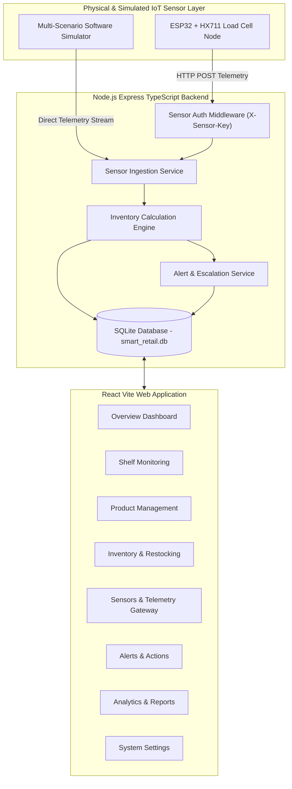
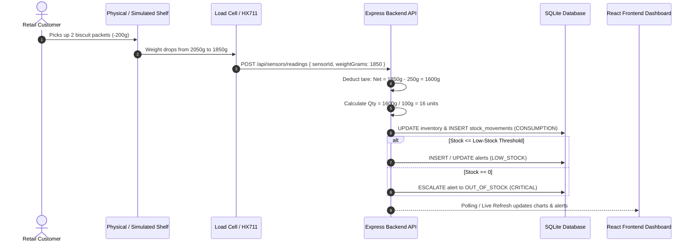
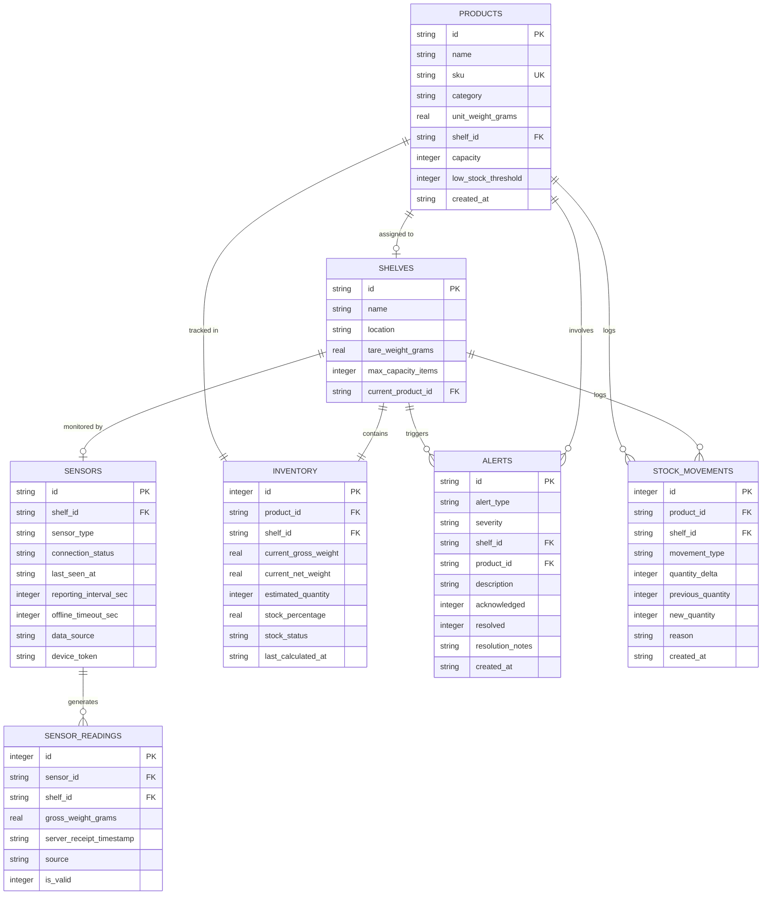

# Smart-Retail Shelf Sensor Network for Real-Time Inventory Monitoring and Automated Restocking Alerts

---

## 1. Project Title
**Smart-Retail Shelf Sensor Network for Real-Time Inventory Monitoring and Automated Restocking Alerts**

---

## 2. Abstract
Traditional retail operations rely extensively on labor-intensive manual barcode audits and visual shelf inspections to track store inventory. This manual approach frequently leads to "phantom inventory," out-of-stock shelves during peak hours, and delayed restocking, directly impacting store revenue and customer satisfaction. The **Smart-Retail Shelf Sensor Network** introduces an automated IoT architecture utilizing strain-gauge load cells (interfaced with HX711 24-bit ADCs and ESP32 microcontrollers) combined with a high-performance Node.js/SQLite backend and a responsive React/Vite dashboard. The system continuously samples gross platform weights, dynamically subtracts platform tare constants, and calculates precise real-time unit counts using calibrated unit weights. Low-stock and out-of-stock conditions are identified instantaneously, automatically raising and escalating alerts, while auto-resolving when shelves are replenished. A built-in multi-scenario software simulator provides complete demo capabilities on any computer without requiring immediate physical hardware, while preserving full hardware-ready ingestion APIs.

---

## 3. Introduction
In competitive retail environments, product availability on physical shelves is critical. When items sell out without prompt store notification, customers either leave empty-handed or choose competing stores. The Smart-Retail Shelf Sensor Network bridges the physical-to-digital gap by turning ordinary supermarket display fixtures into autonomous, self-reporting inventory scales.

---

## 4. Problem Statement
1. **Unnoticed Stockouts**: Floor personnel often discover empty shelves only after customers complain or at the end of business days.
2. **High Labor Costs**: Periodic manual cycle counts waste staff hours that could be dedicated to customer service.
3. **Sensor Jitter & Noise**: Direct raw weight readings fluctuate due to ambient shelf vibrations, leading to false alerts if not filtered properly.
4. **Lack of Historical Analytics**: Retail managers lack granular time-series data showing exact velocity of product depletion across shopping hours.

---

## 5. Objectives
- **Automated Weight-Based Counting**: Accurately translate weight fluctuations into discrete item quantities.
- **Instant Restocking Alerts**: Raise automated warnings when quantity reaches or drops below configurable thresholds.
- **Sensor Connectivity & Heartbeat Monitoring**: Automatically detect disconnected or offline sensor nodes when telemetry stops.
- **Stock Movement Audit Trail**: Automatically record consumption pickups, manual audits, and restocking batches with timestamps.
- **Software Sensor Simulator**: Provide realistic customer pickup and restock scenarios with mechanical noise modeling for presentations and development.
- **Future-Proof IoT Interface**: Provide documented firmware, pinouts, and authenticated HTTP endpoints for real ESP32 + HX711 hardware.

---

## 6. Existing System vs. Proposed System

| Feature | Existing Manual System | Smart-Retail Proposed System |
| :--- | :--- | :--- |
| **Inventory Tracking** | Periodic manual barcode scans | Continuous load-cell weight telemetry |
| **Stockout Detection** | Delayed (hours or days) | Instantaneous (sub-second) |
| **Restock Workflow** | Reactive upon discovery | Proactive automated alert escalation |
| **Shelf State Visibility** | Estimated or stale | Live percentage fill and gross/net weights |
| **Sensor Fault Tolerance** | None | Automatic heartbeat timeout detection |
| **Audit Log** | High error margin paper/manual logs | Atomic SQLite transactions & movement logs |

---

## 7. Features
- **Overview Dashboard**: High-level KPI cards (Total Products, In-Stock Shelves, Sensors Online, Active Alerts), interactive shelf fill distribution chart, inventory condition breakdown donut, urgent restocking list, and live activity stream.
- **Shelf Monitoring**: Complete bay matrix displaying live progress bars, tare weights, current product assignments, and direct links to historical readings.
- **Product Catalog Management**: Full CRUD operations with duplicate SKU validation, category filtering, search, unit weight calibration in grams, and shelf capacity configuration.
- **Inventory & Restocking Engine**: Real-time stock counts, manual inventory adjustment dialogs, atomic restocking workflows with movement logging, and one-click CSV report exports.
- **Sensor Devices Gateway**: Hardware node health monitoring, timeout countdowns, raw packet inspector, and manual telemetry packet injection for testing.
- **Alerts & Escalation Center**: Severity-coded alerts (`CRITICAL`, `WARNING`, `INFO`), deduplication engine, escalation from low-stock to out-of-stock, staff acknowledgement, and resolution workflows with action notes.
- **Analytics & Reports**: Visual charts for stockout frequency by SKU, category volume distribution, shelf fill rate leaderboards, and CSV reporting.
- **Customizable Settings**: Persistent settings for store profile, offline timeout threshold, reporting frequency, default low-stock triggers, and ESP32 hardware authentication secret.

---

## 8. Technology Stack

### Frontend
- **Framework**: React 18 with TypeScript
- **Bundler & Dev Server**: Vite
- **Styling**: Tailwind CSS with custom glassmorphism and animated badges
- **Routing**: React Router DOM (v6)
- **Charts & Data Visualization**: Recharts
- **Icons**: Lucide React

### Backend
- **Runtime**: Node.js (v20+)
- **Server Framework**: Express.js with TypeScript
- **Database**: SQLite with `better-sqlite3` (WAL mode enabled, foreign keys enforced)
- **Schema Validation**: Zod
- **Testing**: Vitest & Supertest
- **Process Orchestration**: TSX & Concurrently

### IoT & Firmware
- **Hardware Targets**: ESP32 DevKit v1, HX711 24-bit ADC amplifier, 4-wire strain-gauge load cell (up to 5kg / 20kg).
- **Communication Protocol**: HTTP POST with JSON payload and `X-Sensor-Key` header authentication.

---

## 9. System Architecture



---

## 10. Data Flow Diagram



---

## 11. Database Design (Entity-Relationship Diagram)



---

## 12. Inventory Calculation Engine Formulation

### 1. Net Product Weight
$$W_{\text{net}} = \max(0, W_{\text{gross}} - W_{\text{tare}})$$
Where:
- $W_{\text{gross}}$: Current measured weight from load-cell ADC.
- $W_{\text{tare}}$: Calibrated empty platform/container weight.

### 2. Estimated Product Quantity
$$Q_{\text{est}} = \operatorname{clamp}\left(\operatorname{round}\left(\frac{W_{\text{net}}}{W_{\text{unit}}}\right), 0, Q_{\text{capacity}}\right)$$
Where:
- $W_{\text{unit}}$: Calibrated single unit weight in grams.
- $Q_{\text{capacity}}$: Physical shelf limit.

### 3. Noise Deadband Filtering
Minor vibrations or mechanical sensor flutter:
$$|\Delta W| < 0.25 \times W_{\text{unit}}$$
Fluctuations smaller than 25% of unit weight are filtered out to prevent alert flapping.

### 4. Stock Status Thresholds
$$\text{Status} = \begin{cases} 
\text{UNKNOWN} & \text{if } W_{\text{unit}} \le 0 \\
\text{OUT\_OF\_STOCK} & \text{if } Q_{\text{est}} = 0 \\
\text{LOW\_STOCK} & \text{if } 0 < Q_{\text{est}} \le Q_{\text{threshold}} \\
\text{IN\_STOCK} & \text{if } Q_{\text{est}} > Q_{\text{threshold}}
\end{cases}$$

---

## 13. Installation & Run Instructions

### Prerequisites
- **Node.js**: v20 or higher
- **npm**: v10 or higher

### Step 1: Clone or Navigate to Project
```bash
cd "Smart Retail"
```

### Step 2: Install All Dependencies
```bash
# Installs root, backend, and frontend dependencies
npm run install:all
```

### Step 3: Run Database Migrations & Seed Data
```bash
npm run seed
```

### Step 4: Run Automated Tests
```bash
npm run test
```

### Step 5: Start Frontend and Backend Concurrently
```bash
npm run dev
```

The system will start:
- **Backend API Server**: `http://localhost:5000`
- **Frontend Dashboard**: `http://localhost:5173`
- **Health Check**: `http://localhost:5000/api/health`

---

## 14. Hardware Integration Guide (ESP32 + HX711)

### Hardware Components
1. **ESP32 DevKit v1 Microcontroller** (Built-in Wi-Fi, 32-bit dual core).
2. **HX711 24-Bit ADC Wheatstone Bridge Amplifier**.
3. **Four-Wire Strain-Gauge Load Cell** (1kg, 5kg, or 20kg capacity).
4. **Platform acrylic or 3D printed fixture**.

### Pin Wiring Schematic
| ESP32 Pin | HX711 Pin | Description |
| :--- | :--- | :--- |
| **GPIO 16 (RX2)** | **DOUT** | Serial Data Output |
| **GPIO 4 (D4)** | **SCK** | Serial Clock Input |
| **3V3 / 5V** | **VCC** | Power Supply |
| **GND** | **GND** | Ground |

### Load Cell Wire Connections
- **Red**: $E+$ (Excitation Positive)
- **Black**: $E-$ (Excitation Negative)
- **White**: $A-$ (Signal Negative)
- **Green**: $A+$ (Signal Positive)

### Firmware Location
The complete, commented Arduino C++ sketch is available in:
[`firmware/esp32_hx711_firmware/esp32_hx711_firmware.ino`](file:///firmware/esp32_hx711_firmware/esp32_hx711_firmware.ino)

### Sample HTTP Ingestion Request (cURL)
```bash
curl -X POST http://localhost:5000/api/sensors/readings \
  -H "Content-Type: application/json" \
  -H "X-Sensor-Key: smart_retail_esp32_secret_token_2026" \
  -d '{
    "sensorId": "SEN-001",
    "weightGrams": 2050.0,
    "source": "HARDWARE"
  }'
```

---

## 15. College Project Demonstration Script (Step-by-Step)

Follow this structured script when presenting the project to faculty or examiners:

### Stage 1: System Overview & Architecture (1 min)
1. Open `http://localhost:5173/` in your browser.
2. Highlight the top navigation header:
   - Point out the **Store Name** (*Metro Fresh Supermarket*).
   - Point out the **Backend API Online** green pulse.
   - Show the **SIMULATION MODE: ACTIVE** badge and **Scenario: Normal Shopping**.
3. Explain the 4 KPI cards: Total Products (13), Shelves In Stock (e.g. 5/8), Sensors Status (7 Online, 1 Offline), and Active Alerts.

### Stage 2: Real-Time Sensor Telemetry Demonstration (2 min)
1. Switch the scenario selector in the top bar to **Rush Hour Depletion**.
2. Notice the live activity feed on the right side of the dashboard: weight packets arrive every 4 seconds.
3. Observe shelves dropping in percentage, transitioning dynamically from green (`IN_STOCK`) to amber (`LOW_STOCK`) and red (`OUT_OF_STOCK`).
4. Navigate to **Alerts & Actions** in the sidebar.
5. Show examiners that when a shelf empties, the alert escalates to **CRITICAL: OUT OF STOCK** without creating duplicate alerts.

### Stage 3: Restocking Workflow & Alert Auto-Recovery (2 min)
1. Click **Inventory & Restock** in the sidebar.
2. Select an out-of-stock product (e.g. *Artisanal Sourdough Loaf* on Shelf `SH-003`).
3. Click the green **Restock** button.
4. Enter quantity `15`, type reason `"Delivery from morning bakery shift"`, and click **Confirm Restock**.
5. Switch to the **Stock Movement History** tab: show the newly recorded `RESTOCK` transaction with exact quantity delta (+15) and weight transition.
6. Return to **Alerts & Actions**: point out that the critical alert for `SH-003` has been **automatically resolved** because inventory recovered above threshold!

### Stage 4: Sensor Heartbeat & Offline Detection (1.5 min)
1. Navigate to **Sensor Devices** in the sidebar.
2. Point out sensor `SEN-008`: it displays an amber **OFFLINE** badge because no readings have been received within the 15-second offline timeout window.
3. Click **Inject Telemetry Packet** for `SEN-008`.
4. Send a weight of `1020g`.
5. Observe the sensor status immediately recover to **ONLINE**, and show that the corresponding `SENSOR_OFFLINE` alert automatically resolves.

### Stage 5: Product Calibration & Custom Shelves (1.5 min)
1. Navigate to **Product Catalog**.
2. Show that each product has a **Calibrated Unit Weight** in grams (e.g. 100g, 150g, 400g).
3. Open an existing product and demonstrate that changing unit weight recalculates live quantities automatically.
4. Show duplicate SKU prevention by attempting to add a product with an existing SKU like `BIS-001`.

### Stage 6: Analytics & Exportable Reports (1 min)
1. Click **Analytics & Reports**.
2. Show the **Stockout & Low-Stock Incident Frequency** bar chart, showing which products run out most frequently.
3. Show the **Category Fill Rates** chart.
4. Click **Export Full Analytics CSV** to show Excel/spreadsheet compatibility.

---

## 16. Automated Test Results
The project includes a comprehensive Vitest test suite covering 23 unit and integration test cases:

```
✓ Smart-Retail Shelf Sensor Network - System Test Suite (23 tests passed)
  ✓ GET /api/health should return UP status
  ✓ Inventory Calculation: tare weight deduction
  ✓ Inventory Calculation: LOW_STOCK identification
  ✓ Inventory Calculation: OUT_OF_STOCK identification
  ✓ Inventory Calculation: clamping to shelf capacity
  ✓ Inventory Calculation: uncalibrated zero unit-weight safety
  ✓ Product Management: list, create, duplicate SKU prevention, update
  ✓ Shelf Management: list shelves, joined product names, create shelf
  ✓ Inventory: restocking transactions, delta logging, CSV export
  ✓ Sensors: simulated telemetry ingestion
  ✓ Sensors: hardware authentication rejection without token
  ✓ Sensors: hardware authentication approval with valid X-Sensor-Key
  ✓ Alerts: retrieval, staff acknowledgement, staff resolution
  ✓ Dashboard: aggregation queries & summary stats
  ✓ Simulation: start, scenario switching, clean stop
```

---

## 17. Troubleshooting
1. **Port 5000 or 5173 already in use**:
   - Change `PORT=5001` in `backend/.env`.
   - Update Vite proxy in `frontend/vite.config.ts`.
2. **Database Locked Error**:
   - The database is configured with SQLite WAL mode (`journal_mode = WAL`). If an external database viewer holds a lock, close the viewer.
3. **Hardware Sensor 401 Unauthorized**:
   - Ensure the ESP32 code includes the HTTP header `X-Sensor-Key: smart_retail_esp32_secret_token_2026`.
